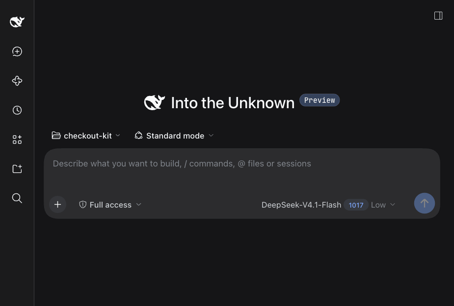

# Spine for DeepSeek Harness (`@spinejit/dsh-spinejit`)

[](https://arxiv.org/abs/2610.37224) [](https://www.npmjs.com/package/@spinejit/dsh-spinejit) [](https://dsh-plugin.org/plugins/GhabiX/dsh-spinejit) [](LICENSE)

English | [简体中文](README.zh-CN.md)

> **Canonical source & npm releases:** Official development and npm Trusted Publishing for [`@spinejit/dsh-spinejit`](https://www.npmjs.com/package/@spinejit/dsh-spinejit) live in [`GhabiX/spine-plugin/packages/dsh`](https://github.com/GhabiX/spine-plugin/tree/main/packages/dsh); this standalone mirror includes prebuilt `dist/` artifacts for GitHub source consumers, and installing via npm (`dsh plugin --profile web add @spinejit/dsh-spinejit`) is recommended.

**Your agent's context, shaped like its task.**

Long-horizon tasks unfold as nested subtasks, yet an agent's context is a flat linear stream where finished explorations and dead ends pile up alongside unfinished work. **Spine** places DeepSeek Harness (DSH) execution under a persistent work tree (**`SpineTree`**, acting as the structural spine of long-horizon work): the agent opens subtasks with explicit goals, switches or closes them locally (`Open`, `Close`, `Next`), and delegates parallel subtrees when needed (`Spawn`). Before each model call, Spine compiles `SpineTree` into minimal effective context—keeping active work in full while folding finished subtasks into their returned conclusions, without breaking prefix caching.



## Highlights

- **Unified work-tree control.** Sequential local steps (`Open` / `Close` / `Next`) and parallel child agents (`Spawn`) are managed together in one `SpineTree`, avoiding unnecessary cross-session subagent overhead on serial work.
- **No separate summarization pass.** Closing a subtask folds its intermediate turns immediately using the conclusion written by the agent while full task context is still fresh; detailed history stays in the session log.
- **Prefix cache keeps hitting.** Completed inner subtasks collapse at the active suffix, leaving preceding parent context byte-for-byte unchanged.
- **Live tree view in Web, Desktop & TUI.** Renders the interactive `SpineTree` in the conversation input dock of DSH Web / Desktop clients and status rows above the prompt in `dsh-tui`.

## Install

Add the plugin to your DSH `web` or `desktop` profile—its bundle patch automatically configures `spinejit` as the context manager:

```bash
# For DSH Web (recommended one-line install)
dsh plugin --profile web add @spinejit/dsh-spinejit
dsh web

# For DSH Desktop (macOS bundled CLI; restart DeepSeek Harness.app and open a new chat)
"/Applications/DeepSeek Harness.app/Contents/Resources/runtime/cli/bin/dsh" plugin --profile desktop add @spinejit/dsh-spinejit
```

Verify installation with `dsh web --dump-config | grep spinejit`. For terminal use, add `@spinejit/dsh-spinejit` to a profile that includes `@deepseek-harness-tui/dsh-tui`.

## Compatibility, Permissions & Scope

- **Category**: Memory & Context (`记忆与上下文`)
- **Supported Profiles & Platforms**: `web`, `desktop`, and `dsh-tui` across macOS, Linux, and Windows
- **Runtime Requirements**: DeepSeek Harness `>=0.2.1-rc.2 <0.3.0-0`, Node.js `>=22.19.0`
- **Permissions & External Services**: Runs 100% locally via the embedded Rust/WASM runtime (`@spinejit/spine-sdk`). Requires **no external network requests, API keys, or cloud services**.
- **Bundle Interaction**: Because Spine owns the session context lifecycle, its `cordis.patch.yml` disables `compaction-basic`, `command-compact`, `tool-result-pruner`, and `image-offload` in the target profile. Do not load other context-rewriting plugins alongside `spinejit`.
- **Upstream Monorepo**: Synchronized from [GhabiX/spine-plugin (`packages/dsh`)](https://github.com/GhabiX/spine-plugin/tree/main/packages/dsh); see also [SpineCodex](https://github.com/GhabiX/SpineCodex) and paper [arXiv:2610.37224](https://arxiv.org/abs/2610.37224).

## How it works

- The model context is the DSH session surface. Each main-loop model request
  is one Spine sampling. In the log it runs from its marked slot (below) to the
  next sampling's slot or to the end of its step, and only that stretch
  decides it: completed if its response was logged whole, cancelled if the
  response was interrupted, failed if none was logged. A Stop after the
  response was logged does not change it. The plugin settles the open
  sampling before the next step and before a retried request; when it
  settles does not change the result.
- Before each request streams, the plugin appends two empty developer slots.
  They derive no model message and leave room for what the sampling puts in
  front of its response (a Next: the closed node's memory); nothing follows
  the response, since a node a call opens is described in that call's
  result. The first is marked
  (`source.sampling`): it records in the log where the sampling began.
- When the next step opens (`agent/request`), the plugin edits the surface into
  the plan the core last published, using standard surface replacements. The
  edits are a pure function of the surface and the plan (`src/projection.ts`),
  and the edited log restores with DSH alone, without this plugin.
- Folded node descriptors, memory and birth records are user messages with
  source `spine`. An opened node's descriptor is in the result of the
  `spine_open` or `spine_next` call that opened it.
- The model sees each user message with its `[U<n>]` number in front, as in
  Pi; the user does not. The logged message, which every client draws, stays
  as the user wrote it. When a step opens, the plugin logs the numbers of the
  user messages it carries in an ignorable `plugin:spinejit/user-anchors`
  record, and a message projection puts each number in front of the message
  the model reads, alike for a live session, a resumed one and a fork. DSH
  builds a step's request from the log right after logging its messages, with
  no point between, so that first request shows a new user message as the user
  wrote it; every later request shows it numbered. Sessions logged by
  dsh-spinejit 0.1.1 and earlier carry the number in the message text and
  resume as they are.
- Host messages (the system prompt, tool registry changes and runtime context)
  are not Spine sources and stay where DSH puts them.
- Before a request streams, the plugin checks that the surface already shows
  the plan with the right user numbers, and refuses the request otherwise.
- A Spine tool call only checks its input. The sampling stages the call whose
  logged result is not an error, so a result another extension turns into an
  error (a `tools/post-execute` block) commits nothing. A model response may
  carry one Spine tool call; a second one is a tool error. A reply is a
  response that stopped by itself (a stream that ends without a finish chunk
  did) with text and no tool call; text cut off at max tokens is an ordinary
  assistant message.
- The session log is the only record of Spine state; the plugin writes no
  archive of its own. The tree records below only show the tree; nothing
  reads Spine state back from them. A resumed session settles each sampling over the same stretch
  of its log with the same code, or up to the end of the log. A
  session whose conversation started without this plugin is refused: its user
  messages were answered unnumbered.
- Spawn: each child is a DSH subagent of its parent, started through the
  subagent service under the plugin's provider `spine`, so DSH owns its
  agent, capacity slot and teardown, and a host that waits for subagents
  (headless, for one) waits for it. Its seed is the parent's log just before
  the sampling whose Spawn bore it (session id `<parent>:spawn:<node>`). The
  step after a Spawn commits starts once its children are established. A
  child gets its assignment as a user message; its last reply is what it
  returns. It is judged each time it goes idle after a turn of its own, by
  the SDK's `childState` over its own log (the events after its
  inherited prefix): with every child of its own arrived, a last reply is
  completed with that memory and a turn that ended on a model error is
  errored with DSH's failure message; cancelled by its parent is aborted;
  idle with every child of its own arrived but neither is errored. After a
  restart the same rule reads the child's persisted log, and a child it
  does not end arrives aborted. A child DSH refuses to start, as past the
  active subagent limit, arrives errored with DSH's reason.
- An arrival is a user message the parent receives once, while its birth is
  open; it wakes the parent unless the parent was stopped. It is handed over
  on the child's idle, before DSH releases the child, so a host never sees
  a running parent done with an arrival still to come. Stopping the
  parent stops its children, whose aborted arrivals wait for the next turn. A
  Close or Next in the sampling that sees the last arrival is accepted: the
  commit joins the arrival first. A restarted parent receives a child that
  returned as completed and any other open birth as aborted, without waking.
- A forked session's inherited prefix is its parent's namespace: births the
  parent made there stay the parent's to join.

## The tree on screen

The tree Pi pins above its editor, drawn by the same code
(`@spinejit/spine-sdk/view`), once the agent has opened a task:

- In the terminal (dsh-tui), up to three status rows above the prompt, without
  the header, always including the cursor's row (`◉`). They show the
  top-level session (not a Spawn child) opened or changed most recently.
- In the web and desktop client, the whole tree in the conversation input
  dock (`dist/client.js`, built by `scripts/build-client.mjs`). The host
  appends a `plugin:spinejit/tree` record (`{cursor, nodes}`) to a session's
  log whenever what its tree shows changes, and the session projection
  `spinejit` serves the latest one to clients.

Sessions logged by dsh-spinejit 0.1.1 and earlier carry `[U<n>]` in the user
text. For them the web and desktop client hide that line in the bubble:
`dist/client.js` registers a user-text rule (`uiConversation.userText`). The
terminal (dsh-tui) has no such seam and still shows it in those old sessions.

## Not yet

- A Spawn child that fails is not retried or continued; its arrival says why.
- Spine tools must be called by the model directly, not from code (PTC).
- Plugins that rewrite conversation context (compaction, tool-result pruning,
  image offload) must not be loaded with this one. Spine owns the context; a
  rewritten source makes the plugin refuse the next request.

## Tests

Tests run the production DSH AgentLoop, session store and official JSONL
persistence with a scripted model adapter (`test/harness.mjs`), and load the
plugin through the Cordis Loader as a DSH bundle does. Each scenario also
checks that the official JSONL restore, without the plugin, equals the live
context.

## License

Licensed under the [Apache License 2.0](LICENSE).
