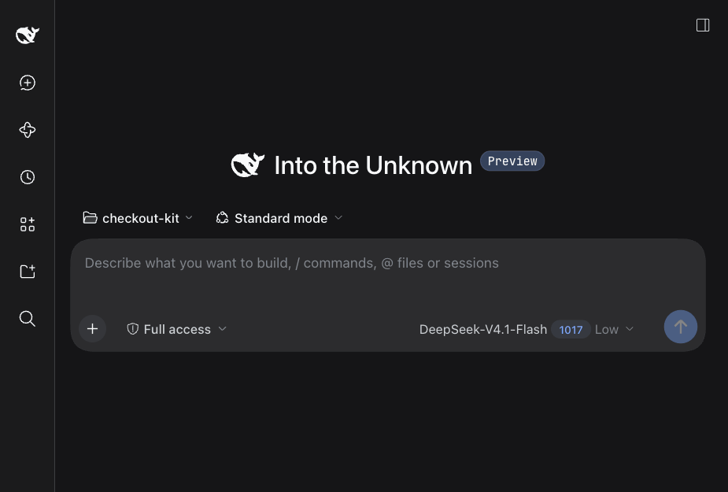

# Spine for DeepSeek Harness (`@spinejit/dsh-spinejit`)

[](https://arxiv.org/abs/2610.37224) [](https://www.npmjs.com/package/@spinejit/dsh-spinejit) [](https://dsh-plugin.org/plugins/GhabiX/dsh-spinejit) [](LICENSE)

[English](README.md) | 简体中文

> **官方发布源说明：** [`@spinejit/dsh-spinejit`](https://www.npmjs.com/package/@spinejit/dsh-spinejit) 的上游主仓库与 npm 官方发布源位于 [`GhabiX/spine-plugin/packages/dsh`](https://github.com/GhabiX/spine-plugin/tree/main/packages/dsh)；本独立镜像仓同步附带预构建 `dist/` 产物以兼容 GitHub 源码直装，日常推荐通过 npm 包名（`dsh plugin --profile web add @spinejit/dsh-spinejit`）安装。

**让智能体的上下文与任务树自然对齐。**

长程任务天然是一棵嵌套的子任务树，但智能体的默认上下文却是一条单向堆积的扁平日志。**Spine** 将 DeepSeek Harness（DSH）的执行过程统一纳入持久化工作树（**`SpineTree`**）管理：智能体在推理时显式开启、切换和闭合本地子任务（`Open`、`Close`、`Next`），并在需要并行分治时委派子树（`Spawn`）；每次调用模型前，运行时根据 `SpineTree` 即时编译出最小有效上下文——完整保留当前活跃步骤，将已完成的子任务自动折叠为其返回结论，同时保持前序上下文逐字节不变以持续命中前缀缓存。



## 安装命令

将插件添加至 DSH 的 `web` 或 `desktop` profile 即可（bundle 配置会自动启用 `spinejit` 接管上下文生命周期）：

```bash
# DSH Web 端一键安装
dsh plugin --profile web add @spinejit/dsh-spinejit
dsh web

# DSH macOS 桌面端（安装后重启一次 DeepSeek Harness.app 并新建对话即可生效）
"/Applications/DeepSeek Harness.app/Contents/Resources/runtime/cli/bin/dsh" plugin --profile desktop add @spinejit/dsh-spinejit
```

## 兼容性、权限与风险说明

- **能力分类**：记忆与上下文（Memory & Context）
- **支持平台与 Profile**：支持 `web`、`desktop` 与 `dsh-tui`（macOS / Linux / Windows）
- **运行环境要求**：DeepSeek Harness `>=0.2.1-rc.2 <0.3.0-0`，Node.js `>=22.19.0`
- **权限与外部服务**：基于本地内嵌 Rust/WASM 核心（`@spinejit/spine-sdk`）纯本地计算，**不发起任何外部网络请求，无需额外 API Key 或第三方服务**。
- **已知限制与冲突说明**：由于 Spine 直接管理会话上下文投影，`cordis.patch.yml` 会自动关闭该 profile 下的默认扁平压缩（`compaction-basic`、`command-compact`、`tool-result-pruner`、`image-offload`），请勿与其他改写对话历史的压缩插件混用；插件仅作用于启用插件后新建的会话。
- **上游仓库与论文**：同步自 [GhabiX/spine-plugin (`packages/dsh`)](https://github.com/GhabiX/spine-plugin/tree/main/packages/dsh)，详见论文 [arXiv:2610.37224](https://arxiv.org/abs/2610.37224) 与 [SpineCodex](https://github.com/GhabiX/SpineCodex)。

## 许可证

采用 [Apache-2.0](LICENSE) 开源许可证发布。
